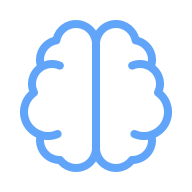
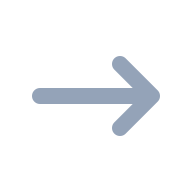

# The Model

 

Imagine you could download your brain onto a disk.

::: Canvas {#engines-row height="400px"}
---
layout:
  brain: [25%, 50%]
  arrow: [50%, 50%]
  disk:  [75%, 50%]
---

{#brain}
{#arrow}
{#disk}
:::

The disk is your "model": it is everything that makes you _you_.
